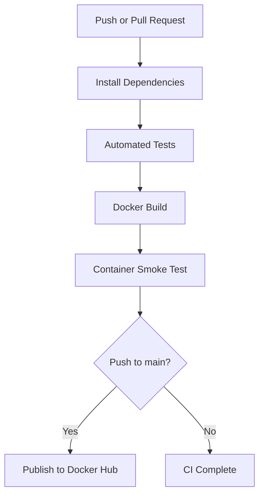
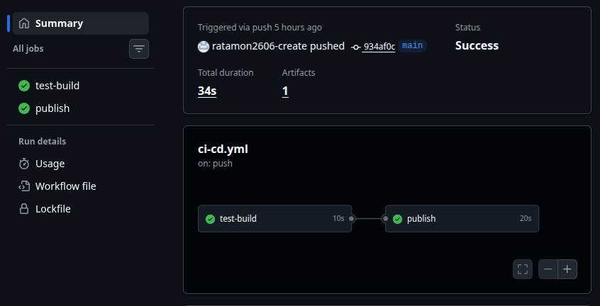
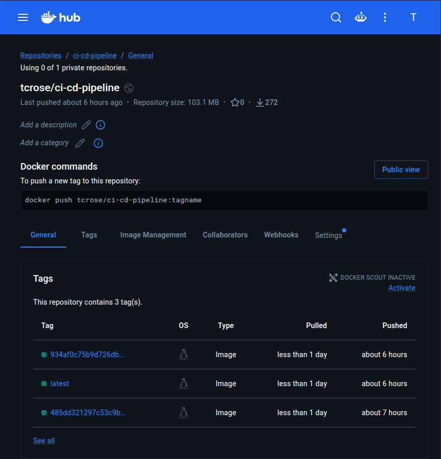

# Docker CI Pipeline

A lightweight Node.js application demonstrating automated
testing, Docker image validation, and container registry publishing
using GitHub Actions.

## Pipeline



## CI/CD Verification

### GitHub Actions — Successful Pipeline



The workflow runs automated HTTP tests, builds the
Docker image, and verifies the application's health
endpoint before publishing.

### Docker Hub — Published Images



After successful validation on the main branch,
the pipeline automatically publishes Docker images
to [Docker Hub](https://hub.docker.com/r/tcrose/ci-cd-pipeline)
using both `latest` and commit SHA tags.


## Tech Stack

- Node.js
- Docker
- GitHub Actions
- Docker Hub

## Automated Checks

- HTTP endpoint tests using Node.js Test Runner
- Docker image build validation
- Container health check
- Docker Hub publishing after successful CI on main

## Run Locally

```bash
npm ci
npm test
docker build -t ci-cd-pipeline:local .
docker run --rm -p 3000:3000 ci-cd-pipeline:local
```

Open http://localhost:3000/health

Expected response:

```json
{"status":"ok"}
```

## Deployment Scope

This pipeline publishes container images to Docker Hub.
It does not automatically deploy the application to a production server.
